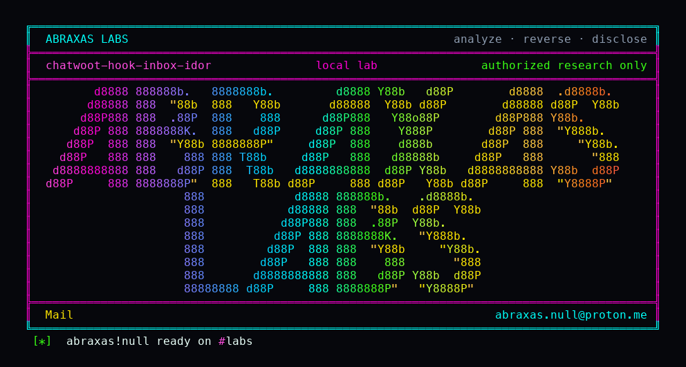

<p align="center">
  
</p>

# chatwoot-hook-inbox-idor

A Chatwoot administrator can create an integration hook on another tenant's inbox by putting that inbox id in the request. The hook lands in the attacker's account, the victim's new conversations start `pending`, the create response echoes the victim's inbox name, and the victim cannot see or delete the hook that is changing their queue.

**Class:** Cross-tenant object reference / authorization bypass
**Reach:** Remote, authenticated account administrator

**Chatwoot** `v4.19.1` - `caab07a8`

| | |
|---|---|
| ID | no CVE yet |
| Class | **Cross-tenant object reference** |
| Reach | **Remote** (administrator of any account) |
| CWE | [CWE-639](https://cwe.mitre.org/data/definitions/639.html) / [CWE-863](https://cwe.mitre.org/data/definitions/863.html) |
| CVSS | **Medium: 6.6** `CVSS:3.1/AV:N/AC:L/PR:H/UI:N/S:C/C:L/I:L/A:L` |
| Product | [Chatwoot](https://github.com/chatwoot/chatwoot) |
| Affected | **v4.19.1** `caab07a8f00032d5205b5a5d7e2eb0ba2f3d2d82` |
| Auth | administrator of any account on the instance |
| License | [GNU Affero GPL v3.0](LICENSE) |
| Lab | loopback Docker compose; Postgres, Redis, Puma, Sidekiq |

## What an attacker can do

| Privilege | Method / sink | Recon / integrity / availability | Lab-proven or inferred |
|---|---|---|---|
| Attach a hook to a foreign inbox | `POST /api/v1/accounts/:attacker/integrations/hooks` with `hook.inbox_id` = victim inbox | Integrity (cross-tenant config) | Lab-proven |
| Read the victim inbox name and id | the same response, `hook.inbox` | Recon (tenant inventory) | Lab-proven. `inbox_name='Victim Support'` |
| Force every new victim conversation to start `pending` | `InboxBotStatus#dialogflow_active?` reads `inbox.hooks` | Availability (workflow) | Lab-proven. Status returns to `open` when the attacker deletes the hook |
| Hide the change from the victim | the hook belongs to the attacker's account | Integrity | Lab-proven. Victim sees 0 dialogflow hooks, attacker sees 1 |
| Keep it in place indefinitely | the victim has no id to delete | Availability | Inferred from the same ownership split |
| Enumerate other tenants' inbox ids | id probing against the create endpoint | Recon | Inferred; the response carries `inbox` with a name only when the id exists |
| Read victim message content through the attacker's Dialogflow project | `HookListener#execute_hooks` | n/a | Closed: the listener walks `message.account.hooks`, so the foreign hook never receives the victim's messages |

**Stays closed on this leftover**

| Axis | Method / sink | Why it is closed |
|---|---|---|
| Recon | Direct inbox read | `InboxPolicy#show?` is account-scoped; lab returns 401 |
| Recon | Message content to the attacker's bot | `HookListener` filters on the message's own account |
| Integrity | Moving or deleting the victim's own hooks | Hook ids are resolved through `Current.account.hooks` |
| Integrity | Creating a hook in the victim's account | `Current.account.hooks.create!` scopes the owner; only `inbox_id` escapes |

## How I found it

The hooks controller permits a field it never scopes:

```ruby
def create
  @hook = Current.account.hooks.create!(permitted_params)
end

def permitted_params
  params.require(:hook).permit(:app_id, :inbox_id, :status, settings: {})
end
```

`Current.account` owns the row, so the hook cannot be read or deleted by the victim. `inbox_id` is taken as given. The model has no matching validation: `belongs_to :inbox, optional: true` and `validates :inbox_id, presence: true, if: -> { hook_type == 'inbox' }`. Nothing compares the inbox's account to the hook's.

`Inbox#has_many :hooks, class_name: 'Integrations::Hook'` is an ordinary `inbox_id` association, so the victim's inbox now reports an active bot:

```ruby
def dialogflow_active?
  hooks.exists?(app_id: %w[dialogflow], status: 'enabled')
end
```

and `Conversation#determine_conversation_status` turns that into `status = :pending` for every new conversation. The create response renders `_hook.json.jbuilder`, which includes `json.inbox resource.inbox&.slice(:id, :name)`, so the attacker also learns the victim inbox name.

Wrong turns: I expected the Dialogflow hook to also ship the victim's messages to the attacker's GCP project, which would have made this a data-exfiltration bug. The listener walks `message.account.hooks`, and the hook is in the attacker's account, so it never fires for the victim's messages. The lab keeps that as a closed axis instead of an overclaim.

## Lab

```bash
python3 chatwoot-hook-inbox-idor-Abraxas-Labs.py
```

or:

```bash
cd lab
./run.sh
```

Two tenants, an inbox each, one contact in the victim tenant. The PoC creates a control conversation that must be `open`, creates the hook with the victim's `inbox_id`, checks the echoed name, proves the attacker still cannot read the victim inbox over HTTP, creates a second victim conversation that must now be `pending`, compares both tenants' integration views, then deletes the hook and confirms the victim's queue recovers.

```text
IOC control_conversation status='open' inbox=1
IOC hook_created id=1 account_id=1 inbox_id=1 inbox_name='Victim Support' status=True
IOC control_victim_reads_own_inbox status=200
IOC control_attacker_reads_victim_inbox status=401
IOC victim_conversation_after_hook status='pending'
IOC victim_visible_dialogflow_hooks=0 attacker_visible_dialogflow_hooks=1
IOC after_attacker_cleanup status='open'
SUCCESS CHATWOOT-F4-HOOK-INBOX-IDOR attacker_account=1 victim_account=2 victim_inbox=1 hook=1 victim_conversation_status=pending victim_cannot_see_hook=true inbox_name='Victim Support' VICTIM-INBOX-NAME-LEAK
```

`run.sh` tears the stack down on exit.

## The fix

Validate the inbox against the account in `Integrations::Hook`, for example `validate :inbox_belongs_to_account`, comparing `inbox.account_id` with `account_id` when both are present. Do it on the model so every write path inherits it, and keep the controller permit list as is.

## References

- [chatwoot/chatwoot](https://github.com/chatwoot/chatwoot) `caab07a8f00032d5205b5a5d7e2eb0ba2f3d2d82`
- [`integrations/hooks_controller.rb`](https://github.com/chatwoot/chatwoot/blob/caab07a8f00032d5205b5a5d7e2eb0ba2f3d2d82/app/controllers/api/v1/accounts/integrations/hooks_controller.rb)
- [`integrations/hook.rb`](https://github.com/chatwoot/chatwoot/blob/caab07a8f00032d5205b5a5d7e2eb0ba2f3d2d82/app/models/integrations/hook.rb)
- [`inbox_bot_status.rb`](https://github.com/chatwoot/chatwoot/blob/caab07a8f00032d5205b5a5d7e2eb0ba2f3d2d82/app/models/concerns/inbox_bot_status.rb)
- [CWE-639](https://cwe.mitre.org/data/definitions/639.html) · [CWE-863](https://cwe.mitre.org/data/definitions/863.html)

## License

GNU Affero GPL v3.0. See [LICENSE](LICENSE). Loopback lab only. No warranty.

Abraxas Labs
abraxas.null@proton.me
